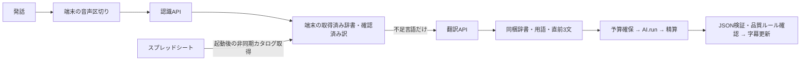

# 翻訳の待ち時間とスプレッドシート参照経路

## 対面通訳の処理

発話中の吹き出し、認識中の吹き出し、原文が得られた後の翻訳待ちの吹き出しを区別する。進捗率や完成時刻を推測せず、未完成の訳を完成済みとして表示しない。

## スプレッドシートとの関係

| 経路 | 参照と待ち方 | 遅延評価での注意 |
|---|---|---|
| 起動後の /catalog | Apps Scriptへ最大20秒の要求。認証後に非同期更新し、保存済み・同梱辞書を先に利用 | 初期辞書の更新は遅くなり得るが、通常の対面 /translate はこの通信を待たない |
| 対面の端末辞書検索 | 取得済みカタログと端末の確認済み訳を検索 | clientLookupMsで測る。シートへ毎回通信する処理ではない |
| 対面 /translate | サーバー同梱catalogで完全一致・用語・訂正ヒントを取得 | 外部シートのfetchを行わない。dictionaryMsは同梱データの検索時間 |
| /transcribe | 同梱辞書を利用。自動二言語判定ではヒント送信なし | シートの更新を待たない |
| チャット・授業 | Durable ObjectのcachedCatalogを利用し、最大5分間隔でwaitUntilによる背景更新 | 翻訳要求で更新完了を直接awaitしない。背景処理による間接的な負荷は別途未計測 |
| じしょ /dictionary/translate | カタログ取得を直接awaitする | ここではApps Scriptやシートの遅さが利用者の待ち時間へ直接影響し得る |

Apps Scriptのカタログ生成は複数シートを読み、tsuyakuRows_ごとにopenByIdとgetDisplayValuesを行う。シート件数、Apps Scriptの実行開始待ち、転送量、端末のJSON解析・再描画時間は別々に測る必要がある。これらを測らず、AI.run内の待ち時間をシートの責任と扱わない。

対面の端末は更新されたシートを利用できるが、翻訳サーバーの用語・訂正は同梱辞書である。更新の一貫性は性能とは別の課題。現行の公開シート内容・Apps Script配備版・同梱辞書の一致は、このコード調査だけでは確認できない。

## 遅延の読み方と次の確認

- firstDisplayは発話開始、speechToDisplayは発話末尾が起点。音声を話した時間を通信待ちと混同しない。
- 認識は無音待ち・送信・AI応答・区間の順序待ちを含む。recognition_orderとclientSlotWaitMsを分ける。
- 翻訳のclientLookupMs、clientQueueMs、clientSlotWaitMs、clientRequestMsと、サーバーのdictionaryMs、providerMs、予算確保・精算を区別する。区間の重なりがあるため、中央値やp95を足し引きしない。
- providerMsはAI.runの待ち時間であり、提供元の計算・内部待機・通信を分離していない。モデルの大きさだけを原因と断定しない。
- 遅い一文について入力・出力トークン数とproviderMsを対応させる。短文でも遅い場合は、文の長さ以外の変動も疑う。
- カタログの取得・解析・画面反映を別計測し、カタログの改訂番号・サイズ・キャッシュ利用元を本文なしで照合する。最新用語の反映経路を確認する。
- 認識設定やモデルを比較する場合は、同じ評価音声と意味保持の基準を使い、価格・誤認識・呼出回数を同時に評価する。速さだけで変更しない。
- ストリーミングはJSON検証・訂正・料金計測・順序保持も必要。未完成の訳の早出しを無条件で有効にしない。

今回の画面変更はCSSアニメーションと状態表示だけ。認識分割・モデル・単価・予算・対象言語・再試行回数・シートの更新頻度は変更しない。利用者の会話本文や端末記録は、この文書へ保存しない。
