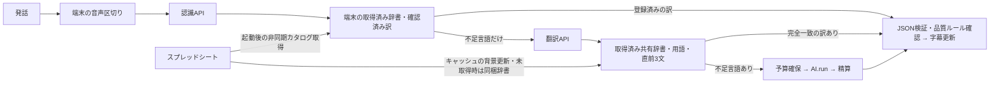

# 翻訳の待ち時間とスプレッドシート参照経路

## 対面通訳の処理

発話中の吹き出し、認識中の吹き出し、原文が得られた後の翻訳待ちの吹き出しを区別する。進捗率や完成時刻を推測せず、未完成の訳を完成済みとして表示しない。

## スプレッドシートとの関係

| 経路 | 参照と待ち方 | 遅延評価での注意 |
|---|---|---|
| 起動後の /catalog | 取得済みキャッシュを再利用。初期・期限切れはApps Scriptへ最大20秒の要求。認証後に非同期更新し、保存済み・同梱辞書を先に利用 | 初期辞書の更新は遅くなり得るが、通常の対面 /translate はこの通信を待たない |
| 対面の端末辞書検索 | 取得済みカタログと端末の確認済み訳を検索 | clientLookupMsで測る。シートへ毎回通信する処理ではない |
| 対面 /translate | 取得済み共有catalogで完全一致・用語・訂正ヒントを取得。未取得時は同梱版 | 外部シートの更新を待たない。dictionaryMsは取得済みデータの検索時間 |
| /transcribe | 同梱辞書を利用。自動二言語判定ではヒント送信なし | シートの更新を待たない |
| チャット・授業 | Durable ObjectのcachedCatalogを利用し、最大5分間隔でwaitUntilによる背景更新 | 翻訳要求で更新完了を直接awaitしない。背景処理による間接的な負荷は別途未計測 |
| じしょ /dictionary/translate | カタログ取得を直接awaitするが、有効な共有キャッシュがあれば再取得しない | ここではApps Scriptやシートの遅さが利用者の待ち時間へ直接影響し得る |

Apps Scriptのカタログ生成は複数シートを読み、tsuyakuRows_ごとにopenByIdとgetDisplayValuesを行う。シート件数、Apps Scriptの実行開始待ち、転送量、端末のJSON解析・再描画時間は別々に測る必要がある。これらを測らず、AI.run内の待ち時間をシートの責任と扱わない。

初版調査では対面サーバーが同梱辞書だけを利用していた。20261029-catalog-pipeline-1から取得済み共有辞書を利用し、未取得時は同梱版で継続する。更新の一貫性は性能とは別に計測する。現行の公開シート内容・Apps Script配備版・同梱辞書の一致は、このコード調査だけでは確認できない。

## 遅延の読み方と次の確認

- firstDisplayは発話開始、speechToDisplayは発話末尾が起点。音声を話した時間を通信待ちと混同しない。
- 認識は無音待ち・送信・AI応答・区間の順序待ちを含む。recognition_orderとclientSlotWaitMsを分ける。
- 翻訳のclientLookupMs、clientQueueMs、clientSlotWaitMs、clientRequestMsと、サーバーのdictionaryMs、providerMs、予算確保・精算を区別する。区間の重なりがあるため、中央値やp95を足し引きしない。
- providerMsはAI.runの待ち時間であり、提供元の計算・内部待機・通信を分離していない。モデルの大きさだけを原因と断定しない。
- 遅い一文について入力・出力トークン数とproviderMsを対応させる。短文でも遅い場合は、文の長さ以外の変動も疑う。
- カタログの取得・解析・画面反映を別計測し、カタログの改訂番号・サイズ・キャッシュ利用元を本文なしで照合する。最新用語の反映経路を確認する。
- 認識設定やモデルを比較する場合は、同じ評価音声と意味保持の基準を使い、価格・誤認識・呼出回数を同時に評価する。速さだけで変更しない。
- ストリーミングはJSON検証・訂正・料金計測・順序保持も必要。未完成の訳の早出しを無条件で有効にしない。

今回の画面変更はCSSアニメーションと状態表示だけ。認識分割・モデル・単価・予算・対象言語・再試行回数・シートの更新頻度は変更しない。利用者の会話本文や端末記録は、この文書へ保存しない。

## 20261029-catalog-pipeline-1

対面の翻訳APIも、取得済みの共有シート辞書を使うよう変更した。初期・期限切れでは同梱辞書または直前の取得済み辞書を使い、実行コンテキストのwaitUntilで背景更新する。翻訳を外部シートの応答で止めない。

/catalog、対面翻訳、じしょ、チャット・授業の背景更新は、同じ実行環境で共有する辞書キャッシュを利用する。取得の同時実行は同じ接続先につき1本、有効期間5分。失敗時は直前の辞書を維持し30秒の再取得抑制。最大4接続先、1件あたりJSONのUTF-16サイズ概算2MBまでとし、認証token・会話・個別の翻訳結果は共有キャッシュに入れない。

これはプロセス内のキャッシュであり、端末間・すべてのWorkerインスタンスで同時に同じ版になる保証ではない。コールドスタートでは同梱辞書へ戻り得る。クライアントとサーバーが使う辞書の変更識別値を比較して、catalogMatchで一致を観測する。識別値は変更追跡用であり署名・承認判定には使わない。

分析の翻訳内訳へcatalogSource、catalogRevision、catalogAgeMs、catalogFresh、catalogMatchを追加する。未取得の一致判定は欠落またはnullで、falseと区別する。カタログ取得のclientRequestMsは認証・通信・解析を含み、catalogApplyMsは端末への保存と画面反映の処理時間。これをそのままApps Script単体の時間とは扱わない。

生成訳の会話内キャッシュにも辞書の識別値を含める。辞書更新によって以前の生成訳をそのまま再利用せず、必要な場合に新しい辞書で翻訳する。AIの追加自動判定や自動再試行は行わない。

検証はキャッシュの有効期限・同時取得・失敗・再取得抑制・件数上限・不正データ、翻訳が取得待ちしないこと、更新用語のAI入力反映、識別値と計測値の本文を含まない保存。実利用での待ち時間短縮率と、各Worker間の版一致率は公開後の実測対象。

### 同梱定型文
対面翻訳の非同期辞書検索は、確認済みストアを含む既存辞書の検索後、no_match の場合だけ同梱の日英7組を検索する。NFCと外側の空白以外は正規化しない。語尾・句読点・大小文字も厳密一致とし、固有名詞や数字を埋め込むテンプレートにはしない。他言語が必要な場合は従来の翻訳へ進む。集計上の再利用元は builtin。スプレッドシート取得元とは別の情報である。

### 待機状態の終了
3秒上限の区切りは音声を送信するだけでなく、収録状態の終了も通知する。次の有声音が始まれば再び収録状態になる。処理がなければ待機吹き出しは隠し、認識・翻訳中は文字なしの3点だけを表示する。既に字幕内の待機表示がある場合は独立した吹き出しを重ねない。
初回の認識提供元の応答待ちは、端末の辞書検索時間と別に評価する。提供元時間は通信・提供元側の待機・推論を含むため、初回に遅かっただけではモデルのコールドスタートと断定しない。
